# 星陨战线 · ASTRAL FRONTIER

一款可**双击直接游玩**的 3D 动漫风 Roguelike 塔防游戏。云海圣所的最后一座星核即将熄灭，召唤星之少女，以「融合共鸣」改写她们的星轨。


| 战斗 | 融合三选一 |
| --- | --- |
| 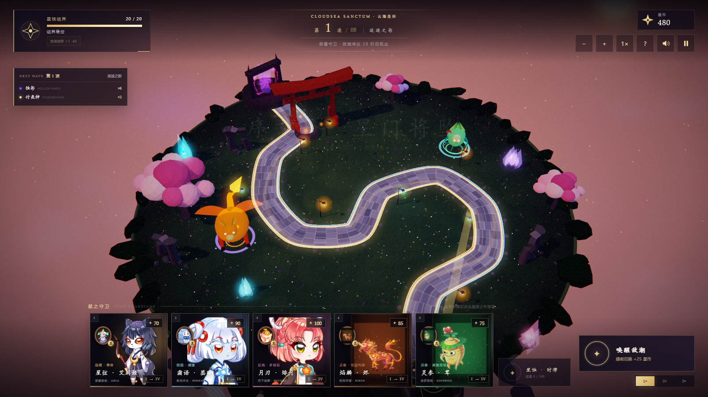 | 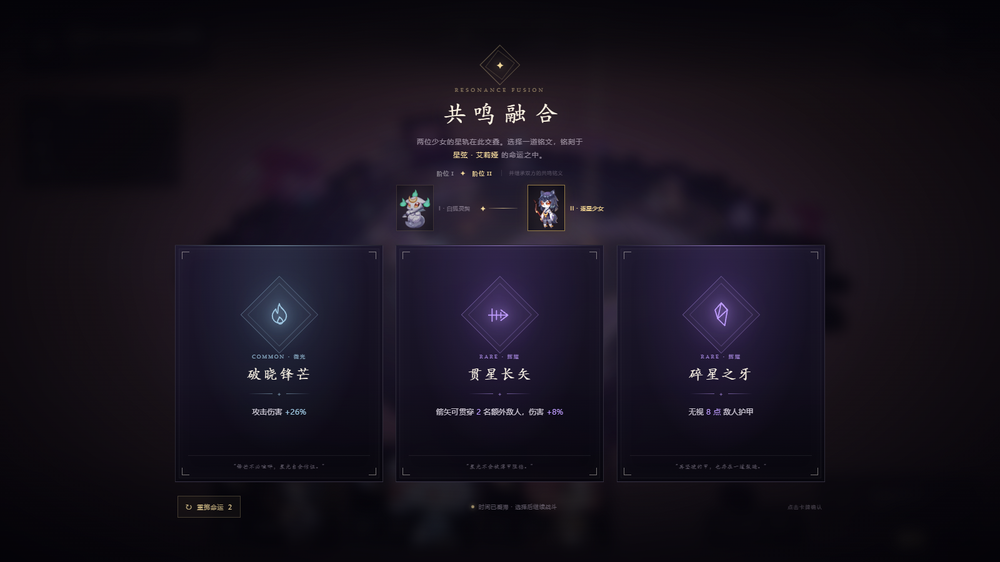 |

| 深渊歌姬 | 通关 |
| --- | --- |
|  |  |

## 塔的 UI 与阶段形态

五位守卫（三位星之少女 + 两位灵兽）各自拥有四段不同的卡面与边框：

| 阶段 | 形态 | UI 表现 |
| --- | --- | --- |
| I | 灵契 | 妖灵幼体卡面、青铜边框、灵契小像 |
| II | 少女 | 人形少女卡面、青蓝边框 |
| III | 觉醒 | 觉醒特写卡面、紫金边框、满幅立绘 |
| IV | 神降 | 神降构图卡面、金色边框、灵兽伴随与光环 |

- 商店卡展示**少女形态主立绘 + 灵契小像 + I→IV 阶段标记**
- 选中守卫后，面板会显示当前阶段的卡面；点击下方四个阶段缩略图，可以**预览**后续形态
- 融合界面展示「当前形态 → 下一形态」，确认后播放**阶位升华**立绘
- 角色卡面与部分卡框来自你提供的《Yokai Art: Night Parade of One Hundred Demons》本地游戏资源；版权归原作者所有

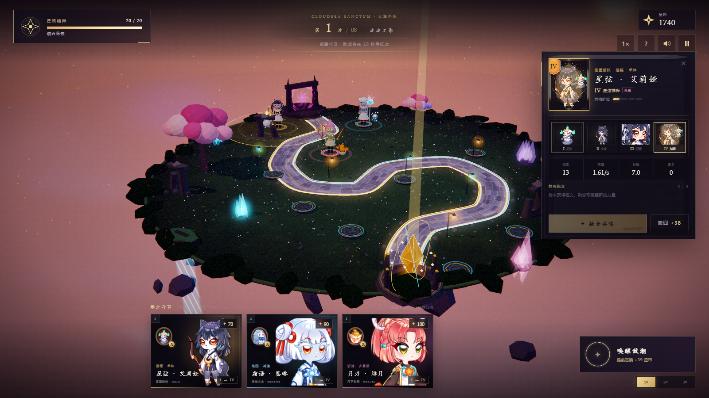

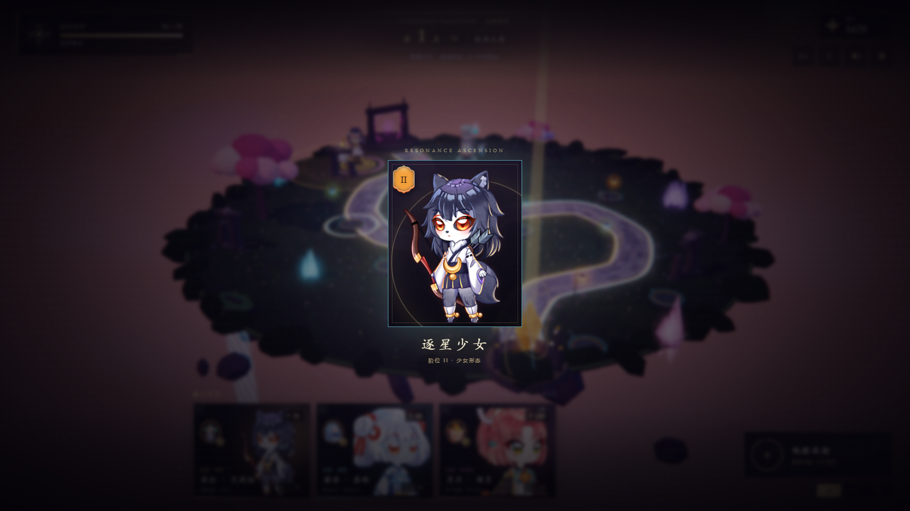

## 3D 重制与攻击动作

三位守卫的 3D 模型已按新卡面重做，不再是原来的金发弓手 / 蓝发法师 / 紫黑剑士：

- **星弦·艾莉娅**：深蓝紫发、狐耳、白色紫纹巫女服、月牙胸饰，身边跟随白狐灵；弓身有金月纹与灵光。
- **霜语·瑟琳**：雪白长发与红绳、苍白肤色、白蓝巫女服、红色腕带，手持霜华杖；身边跟随雪灵。
- **月刃·绯月**：粉色短发、白色小角、金白羽衣与青绿绳结，双持焰刃；身边跟随凰雏。

阶段变化也做进了 3D 模型：

| 阶段 | 3D 变化 |
| --- | --- |
| I 灵契 | 灵兽伴随最大、最醒目；少女保持素装 |
| II 少女 | 狐面 / 红绳 / 肩甲 / 背帛出现 |
| III 觉醒 | 灵能狐尾 / 冰晶翼 / 焰羽翼展开，光环出现 |
| IV 神降 | 翼展进一步放大，金色冠冕、神环与神降披帛 |

攻击动作按角色重做：

- **星弦**：抬弓 → 拉弦蓄力 → 放箭回弹 → 收势，弓上出现搭箭与灵光。
- **霜语**：法杖抬起 → 霜环在脚下展开 → 霜球膨胀 → 推出释放，法杖雪华旋转。
- **月刃**：左右交替的交叉斩 → 身体突进 → 双刃回旋 → 焰翼展开，配合双重斩击与火星。

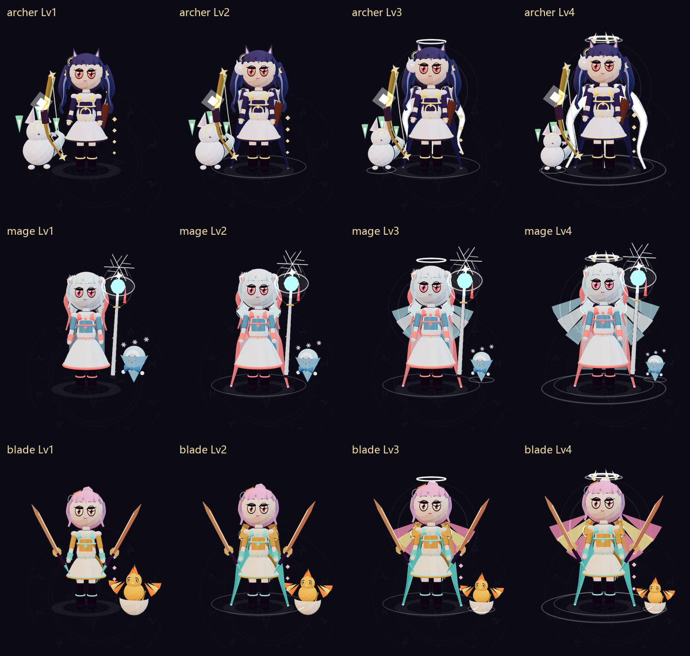

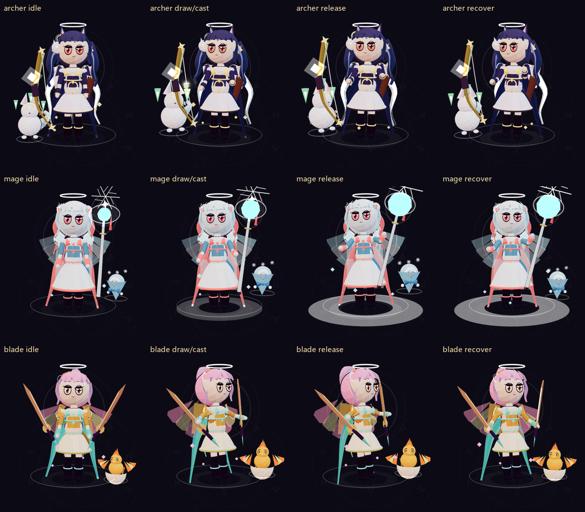

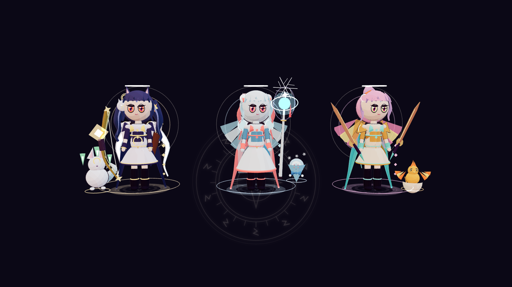

## 灵兽守卫：焰麟与灵参

第 4 / 5 位守卫来自素材库的妖怪原画，经过重新构图、调色与四阶特效加工：

- **焰麟 · 烬**：火麒麟，范围灼烧/溅射，高单发；I–IV 阶逐步长出冠角、焰翼与神环。
- **灵参 · 茸**：人参精，根须减速、光环控场；I–IV 阶逐步展开叶冠、根环与森罗光晕。
- 两位都有独立 3D 模型、四阶卡面、攻击投射物、融合三选一与强化环。
- 卡面由 `assets/yokai/` 的透明帧加工为 512×640 PNG；3D 模型为程序化灵兽骨架。

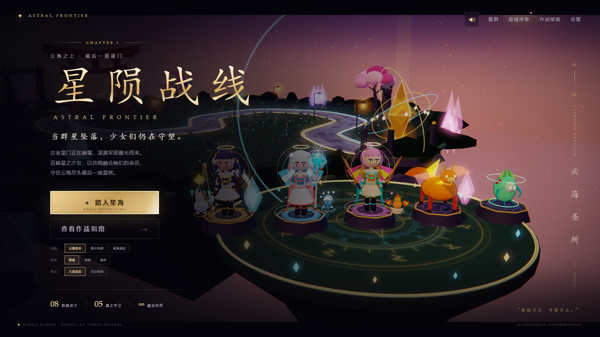

## 一键开始

- 双击 **`index.html`** 即可开始。
- 也可以双击 **`启动游戏.bat`**，自动用默认浏览器打开。
- 无需安装、无需服务器、无需联网。3D 场景、角色、音频与大部分 UI 均在本地生成，塔卡面来自你提供的本地素材。
- 推荐 Chrome / Edge 桌面版，开启硬件加速。

## Steam 与 EXE

Steam 版不需要重写引擎。最省路径是把现有 WebGL 页面原样放进 **Electron**：

- `electron/main.js` 创建无菜单栏、全屏、单实例的 `BrowserWindow`；
- `preload.js` 用 `contextBridge` 暴露 `steam.*`；
- `steamworks.js` 接成就、统计、云存档、富状态；
- 用 `electron-builder` 打出 Windows `.exe`，后续再做 Linux `.AppImage` 给 Steam Deck。

当前版本仍然可以直接双击 `index.html` 运行；EXE 打包不影响内容迭代。详细发行、素材规格、定价和时间表见 **[docs/Steam上线方案.md](docs/Steam上线方案.md)**。

## 游戏内容

- **3 张主题战场**：云海圣所 / 熔火回廊 / 星海遗迹。三张图拥有独立星路、主题色、滤镜、波次混编与最终 Boss。
- **3 个 Boss**：深渊歌姬 · 塞拉菲娜、熔火歌姬 · 伊格妮丝、星海遗孀 · 诺克提斯，均支持三阶段。
- **15 种敌人**：基础 5 种 + 妖怪 5 种 + 裂影/盾卫/祭影 3 种 + 2 个地图 Boss，包含护盾、治疗、分裂等机制。
- **5 位守卫**：3 位 3D 星之少女 + 焰麟 / 灵参两位灵兽，全部支持 I–IV 阶融合。
- **3 位 3D 星之少女**，实时待机、攻击与升阶动画：
  - 星弦 · 艾莉娅：远程单体，优先狙击最接近星核的敌人。
  - 霜语 · 瑟琳：范围霜爆，减速与冻结。
  - 月刃 · 绯月：近战多目标，流血与月影爆发。
- **自由布防**：星路之外的草地都可以部署，不再受固定法阵限制；绿色预览可放置，红色会提示星路、星核、地形或守卫间距冲突。月刃基础射程已从 3.5 调到 4.5，贴近星路即可覆盖。
- **融合共鸣**：两名**同类型、同阶位**的守卫可以融合。融合会消耗其中一名，升阶并继承双方的共鸣铭文，然后进入**三选一**的 Roguelike 强化。
- **45 枚共鸣铭文**，分为微光 / 辉耀 / 星辉三档稀有度，包含攻速、暴击、贯穿、连锁、霜爆、流血、处刑、箭雨、永冬等领域与类型专属构筑。
- **命运重掷**：初始 2 次，每 3 波额外获得 1 次。
- 星币经济、提前召唤奖励、敌人护甲、Boss 血条、星核结界、胜负结算与重新远征。

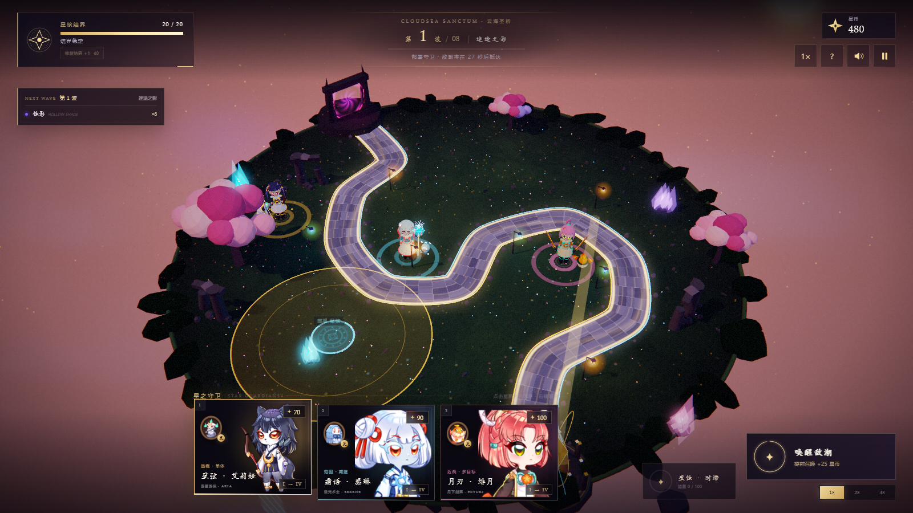

## 剧情序章：星门将坠

主菜单右上角新增 **「剧情序章」**。序章包含 7 段可翻阅的剧情，从星门崩裂、三位守卫集结，到塞拉菲娜现身、艾莉娅立誓守住星核。

- 支持逐段阅读、跳过与关闭；读完会记录到本地，菜单入口不再显示未读圆点。
- 角色立绘复用塔卡面，旁白/歌姬使用单独的文字氛围板。
- 文本与后续多关卡框架分离在 `js/story.js`，下一关可以直接追加章节。
- 剧情数据先做了「云海圣所」序章，后续关卡会沿星门崩裂的主线展开。

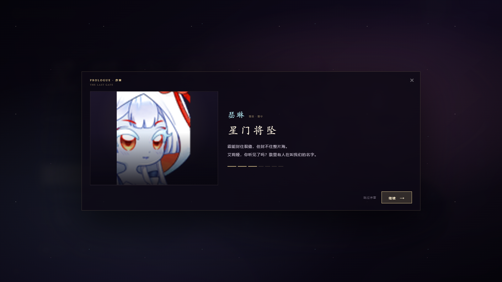

## 3D 阶段升级反馈

塔的 3D 模型现在不仅随融合阶位重建，还会在**星辉强化**后立即重建：

- I–IV 阶使用不同阶位地面环：青铜 / 冰蓝 / 紫 / 金。
- 每次阶位提升，模型会放大、增加阶位光点；III/IV 阶保留翼、冠冕、光环等轮廓变化。
- 星辉强化每购买 1 级，塔脚增加一圈金色强化环，最多 3 圈。
- 融合与强化都会立即替换场景中的模型，不需要重开波次。

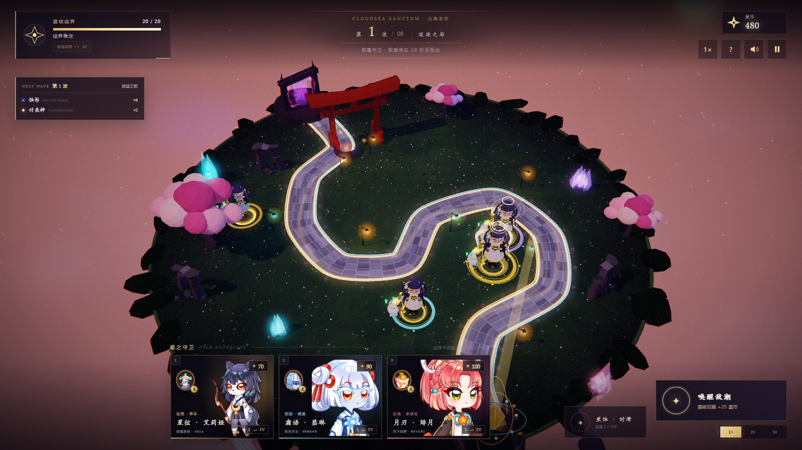

## 地图缩放、星图与每日挑战

- **地图缩放**：游戏中滚动鼠标滚轮，或点击右上角 `− / ＋`，可在 0.68×–1.55× 间缩放；会取消开场相机缓动，缩放立即生效。
- **局外星图**：主菜单「星图」进入档案，用远征获得的星尘购买 4 类永久升级：开局星币、星核上限、初始重掷、全守卫伤害。
- **20 个成就**：进度、构筑、挑战、收集四类；档案里可查看已解锁与未解锁条件。
- **每日挑战**：星图面板里的「今日挑战」会按日期轮换地图与难度，不依赖服务器；完成后计入每日成就。
- 星图、成就、每日记录都写入本地 `localStorage`，与局内检查点分离。

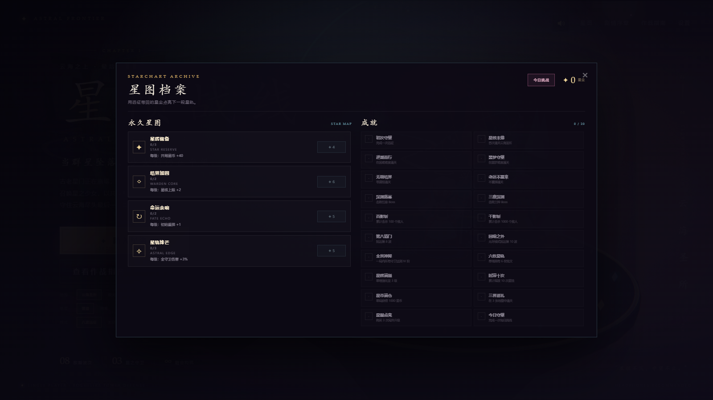

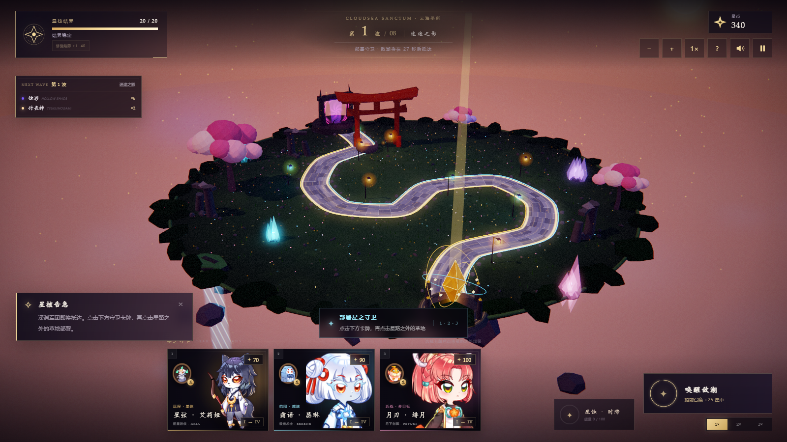

## 增强版素材合并

已把 `D:\99-agent-星陨战线-增强版` 的增量内容合并进当前版本，主逻辑不回退：

- **5 种妖怪小兵**：火麒麟、付丧神、飞头蛮、菌妖、人参精，使用 9–12 帧横向精灵图，已混入 8 波普通波次。
- **妖怪动画**：在 `file://` 下通过手动 `` 载入，避免 CORS 失败；已修复原增强版首次加载不显示贴图的 guard 问题。
- **场景道具**：神社鸟居、圣火盆、深渊传送门风暴，来自增强版 `extras.js` / `models_data.js`。
- 妖怪血条高度、数量混波与当前难度/自由布防兼容。

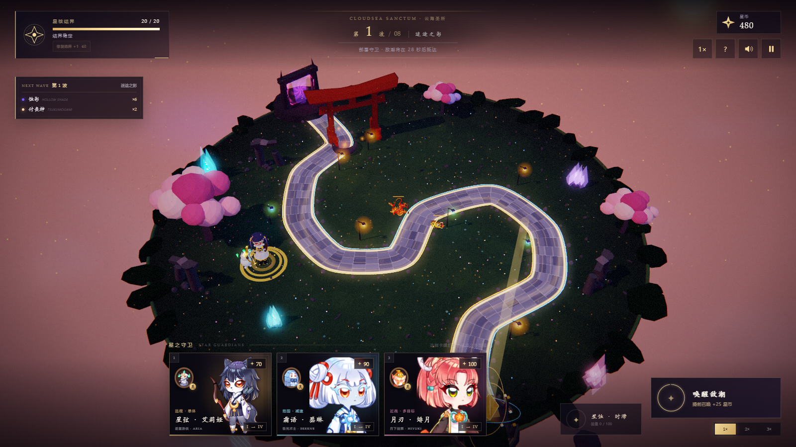

完整替换规格单独放在 **[docs/美术资产替换规格.md](docs/美术资产替换规格.md)**：包含塔卡面、I–IV 阶 GLB、普通小兵、Boss、2D 精灵条带、命名、尺寸、朝向、动画与验收标准。

## P0 系统迭代

这轮按《塔防差距分析与迭代路线图》的 P0 优先级补上了六项系统：

- **金币出口**：每座塔可在选中面板进行 3 级「星辉强化」，费用 60 / 120 / 200，每级 +10% 伤害、+8% 攻速；融合会继承双方较高的强化等级。
- **波次信息**：左侧新增下一波预告，显示敌人类型、数量、护甲、飞行、高速标签。
- **敌人可读性**：敌人血条上方显示「甲 / 飞 / 疾」；伤害被护甲吃掉较多时，飘出灰色「护甲 -X」。
- **目标优先级**：选中塔后可切换「最前 / 最后 / 最强 / 最近」，三种塔各自有默认策略。
- **波内操作**：击杀积攒星蚀能量，满 100 按 `Q` 或点右下角按钮释放「星蚀 · 时滞」，全场减速 70% 持续 3.5 秒，冷却 40 秒。
- **失败缓冲**：布防期可花 40 星币修复 1 点星核结界，每局最多 3 次；Boss 穿线伤害改为 12。
- **结算报告**：S/A/B/C 评级、每塔有效伤害条形图、漏怪归因（最后一次漏怪、主要威胁、当时守卫数量）。
- **经济重调**：初始星币 340，击杀金币 ×0.75，波次奖励 ×1.1，提前召唤奖励上限 25。

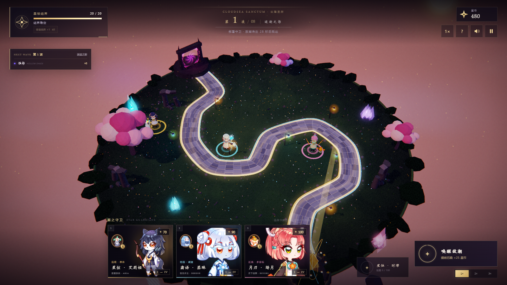

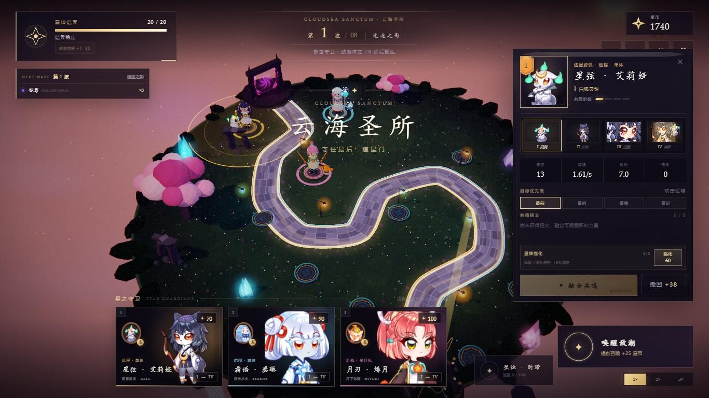

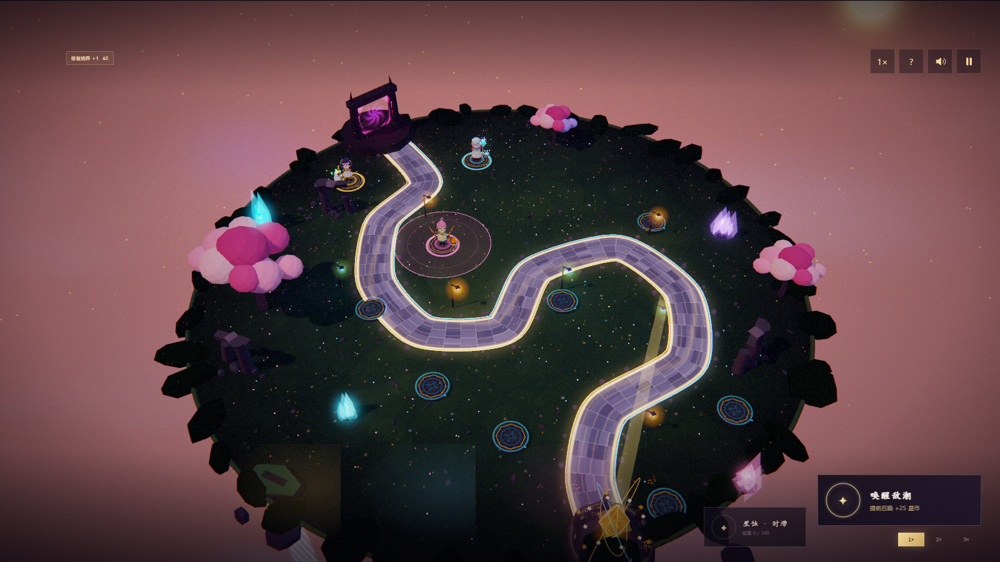

## P1 迭代：Boss、难度、无尽、存档与设置

- **Boss 三阶段**：66% 血量进入「相位 II · 唤潮」，预警 2 秒后召唤 2 飞灵 + 2 蚀影；33% 进入「相位 III · 终幕」，获得 800 护盾，并使守卫攻速降低 30% 持续 4 秒。护盾条独立显示，破盾后才能继续扣血。三张地图各有专属 Boss。
- **难度三档**：普通 / 困难 / 噩梦。困难提高敌潮 HP、速度与护甲并降低星核上限；噩梦进一步压缩容错。
- **3 张主题战场**：云海圣所 / 熔火回廊 / 星海遗迹，各自拥有独立星路、主题色、滤镜、混编波次与 Boss。
- **无尽回响**：八波标准远征之外可选无尽模式，波次无限、每 5 个无尽波出现一次当前地图 Boss；HUD 波次上限显示为 `∞`。
- **局中存档**：每波结束自动写入本地检查点；菜单出现「继续上次远征」，刷新页面后可以恢复难度、波次、星币、星核、守卫等级/铭文/强化/目标优先级。
- **设置面板**：主音量滑杆、画质高低中（影响渲染 DPR）、界面字号、动态效果减弱。动态效果减弱会关闭震屏与闪白，并缩短 CSS 动画。
- **移动端**：按要求跳过，不再投入竖屏/触控适配。


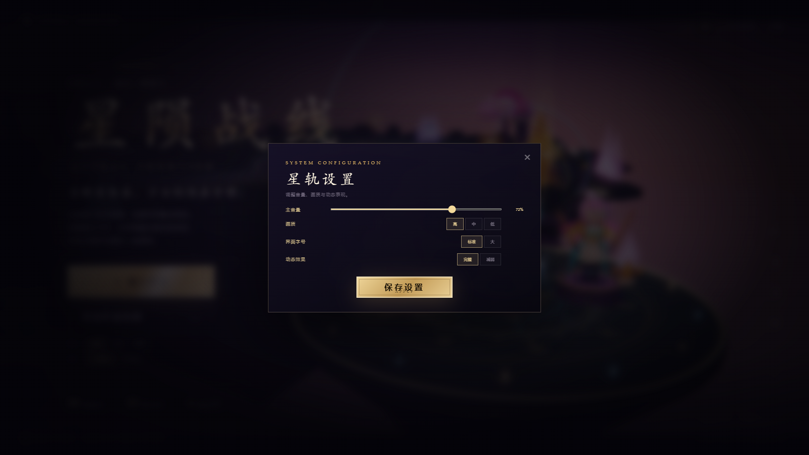

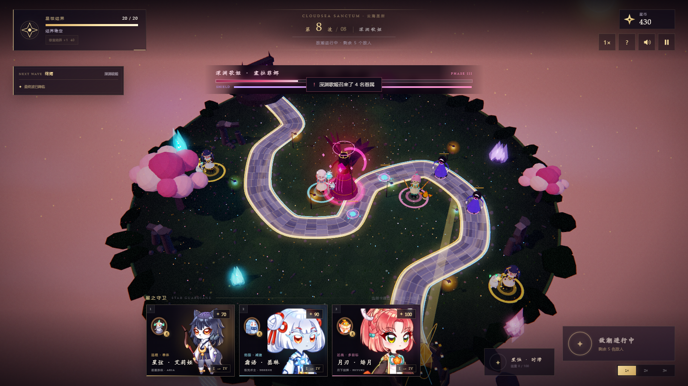

## 操作

| 操作 | 说明 |
| --- | --- |
| 主菜单「星图」 | 局外升级、20 个成就、今日挑战 |
| 主菜单「剧情序章」 | 阅读序章；可跳过或逐段翻阅 |
| 主菜单「地图」 | 云海圣所 / 熔火回廊 / 星海遗迹 |
| 游戏中滚轮 / 右上角 − ＋ | 地图缩放 0.68×–1.55× |
| 主菜单「难度 / 模式」 | 选择普通、困难、噩梦；八波远征或无尽回响 |
| 主菜单「继续上次远征」 | 从上一波结束的本地检查点恢复 |
| 主菜单「设置」 | 调整音量、画质、字号与动态效果 |
| 点击底部卡牌 → 点击星路外草地 | 部署守卫 |
| 点击已部署守卫 | 查看属性与铭文 |
| 融合共鸣 → 点击发光同伴 | 融合两名同类型同阶守卫 |
| `1` / `2` / `3` | 快速选择守卫 |
| `Q` | 释放星蚀 · 时滞 |
| 选中守卫后 | 切换目标优先级、购买星辉强化 |
| 布防期核心面板 | 花 40 星币修复 1 点结界 |
| 鼠标悬停 | 显示射程预览 |
| `Space` | 提前召唤敌潮 / 暂停 |
| `Esc` | 取消选择 / 暂停 |
| `P` | 暂停 |
| `M` | 静音 |
| 右键 | 取消当前操作 |

## 视觉与技术

- Three.js r158（本地 UMD 构建，无 CDN 依赖）。
- 自写后处理管线：Bloom、ACES 色调映射、色差、暗角、胶片颗粒、色彩分级。
- 全程序化 3D：动漫少女、深渊敌人、星核、浮空岛、樱花树、瀑布、云海、星空。
- 五位守卫拥有独立的 3D 轮廓/灵兽骨架、武器、阶段羽翼与攻击动作；攻击特效会随阶位变色。
- 动态 Toon 着色、轮廓线、Rim Light、接触阴影、粒子与屏幕震动。
- 实时程序化配乐与音效（Web Audio API），无外部音频文件。
- 性能优化：静态地形阴影烘焙、植被实例化、战斗角色 LOD（收起细轮廓）、DPR 封顶。

## 文件结构

```
星陨战线/
├─ index.html          # 双击开始
├─ 启动游戏.bat         # Windows 一键启动
├─ README.md
├─ css/main.css        # 视觉系统与全部 UI
├─ js/
│  ├─ three.min.js     # Three.js r158（本地）
│  ├─ data.js          # 守卫、15 种敌人、3 张地图、45 枚铭文、三 Boss
│  ├─ audio.js         # 程序化配乐与音效
│  ├─ art.js           # 少女/敌人/粒子/后处理/立绘渲染
│  ├─ world.js         # 云海圣所、星路、星核、舞台
│  ├─ models_data.js   # 增强版追加道具的内嵌几何
│  ├─ extras.js        # 神社鸟居 / 圣火盆 / 深渊风暴
│  ├─ yokai.js         # 妖怪小兵 2D 精灵与波次混入
│  ├─ meta.js          # 星图升级 / 20 个成就 / 每日挑战定义
│  ├─ story.js         # 剧情序章文本与章节数据
│  └─ game.js          # 玩法、波次、融合、UI、相机、存档
├─ assets/
│  ├─ cards/           # 五位守卫 × 四阶段卡面
│  ├─ yokai/           # 五种妖怪的横向精灵图
│  └─ ui/              # 原作卡框、灵契圆框、阶段纹章
├─ docs/
│  ├─ 美术资产替换规格.md
│  └─ Steam上线方案.md
├─ screenshots/        # 预览图
├─ THIRD_PARTY_NOTICES.md
└─ README.md
```

## 小提示

- 两名同类型、同阶位守卫才能融合；融合会消耗一名，但会继承双方的铭文。
- 守卫最高 IV 阶。高阶后再融合会失去继续成长的空间，请谨慎选择融合对象。
- Boss 抵达星核会造成 12 点伤害；布防期可用星币修复结界，避免一次漏怪直接终结远征。
- 提前召唤敌潮会给额外星币，但也会让防线更早承压。
- 如果你想要更轻松的构筑，优先把两名相同守卫融合到 III / IV 阶，再补足射程与攻速。

## 故障排查

- **黑屏 / 无法进入 3D**：确认浏览器开启了硬件加速，并支持 WebGL2。
- **打开后没有声音**：浏览器要求先点击页面才能启动音频；点击「踏入星海」或任意按钮即可。
- **字体不理想**：UI 优先使用系统楷体 / 微软雅黑，在 Windows 上效果最佳。
- 如果个别浏览器限制 `file://` 权限，可在项目目录执行 `python -m http.server 8080`，再访问 `http://localhost:8080`（本项目本身不依赖服务器）。

## 第三方

- [Three.js](https://threejs.org/) r158 — MIT License。
- 角色卡面与部分 UI 卡框取自用户提供的本地游戏《Yokai Art: Night Parade of One Hundred Demons》资源，版权归原作者所有，本项目仅在本地作为 UI 演示使用。
- `assets/yokai/` 的妖怪精灵条带、`js/yokai.js` 的妖怪接入，以及 `js/extras.js` / `js/models_data.js` 的神社与深渊风暴几何，同样来自该本地资源包的增量合并；仅作本地演示。
- 其余代码、3D 角色、场景、程序化 UI、剧情文本与音频均在本项目内生成。

---

**星核不灭，守望不止。**
